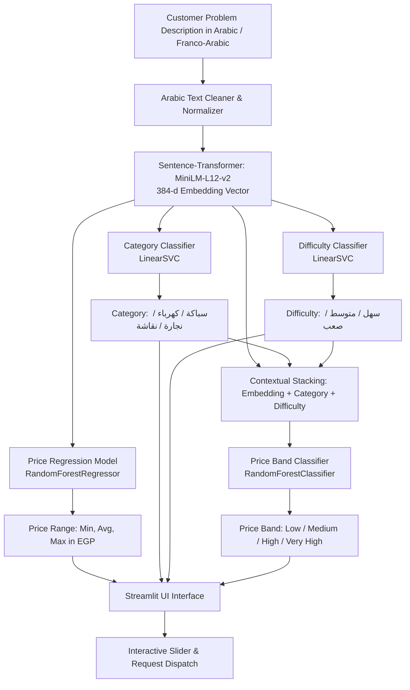

# 🔧 Sal7ly (صَلِّحلي) — AI-Powered Home Maintenance Pricing Engine

[](https://www.python.org/)
[](https://streamlit.io/)
[](https://huggingface.co/sentence-transformers/paraphrase-multilingual-MiniLM-L12-v2)
[](https://scikit-learn.org/)
[](LICENSE)

An intelligent, **inDrive-style dynamic pricing & service classification platform** tailored for the Egyptian home maintenance and craftsmanship market (سباكة، كهرباء، نجارة، نقاشة). 

Users submit their issues in natural Egyptian Arabic / colloquial text, and the end-to-end NLP/ML pipeline automatically classifies the service category, assesses task difficulty, predicts fair market pricing (minimum, average, and maximum in EGP), categorizes price tiers, and lets users fine-tune and dispatch service requests.

---

## 📌 Table of Contents

- [Overview & Key Features](#-overview--key-features)
- [System Architecture & ML Pipeline](#-system-architecture--ml-pipeline)
- [Model Zoo & Benchmarks](#-model-zoo--benchmarks)
- [Project Structure](#-project-structure)
- [Installation & Setup](#-installation--setup)
- [Running the Application](#-running-the-application)
- [Domain Specifications](#-domain-specifications)
- [Configuration & Artifacts](#-configuration--artifacts)
- [Contributing & License](#-contributing--license)

---

## 🌟 Overview & Key Features

- **Egyptian Dialect & Arabic NLP**: Customized preprocessing pipeline handling Arabic diacritics (`Tashkeel`), elongation (`Tatweel`), character normalization (Alef, Yaa, Taa Marbuta variants), and domain-specific stop patterns.
- **Multilingual Semantic Embeddings**: Utilizes [`sentence-transformers/paraphrase-multilingual-MiniLM-L12-v2`](https://huggingface.co/sentence-transformers/paraphrase-multilingual-MiniLM-L12-v2) to extract 384-dimensional dense semantic vectors from unstructured Arabic problem descriptions.
- **Multi-Task Machine Learning**:
  - **Category Classification**: Identifies trade disciplines (`سباكة`, `كهرباء`, `نجارة`, `نقاشة`).
  - **Difficulty Estimation**: Gauges complexity (`easy` / سهل, `medium` / متوسط, `hard` / صعب).
  - **Multi-Output Price Regression**: Concurrently predicts a realistic price window (`[min_price, avg_price, max_price]`) in Egyptian Pounds (EGP).
  - **Enhanced Price Band Classifier**: Predicts price brackets (`low`, `medium`, `high`, `very_high`) by stacking text embeddings with one-hot encoded category and difficulty features.
- **Interactive inDrive-Style Web Experience**: Modern, dark-mode Streamlit dashboard featuring live AI preview tags, animated price cards, interactive price-adjustment sliders (25 EGP steps), and instant request submission.

---

## 🏗️ System Architecture & ML Pipeline



---

## 🧠 Model Zoo & Benchmarks

All models are serialized in `models/` as optimized `joblib` artifacts:

| Task | Model Type | Feature Representation | Outputs | Evaluation / Performance |
| :--- | :--- | :--- | :--- | :--- |
| **Category Classification** | `LinearSVC` | Normalized MiniLM-L12-v2 (384-d) | `category` (4 classes) | High F1-score across trades |
| **Difficulty Estimation** | `LinearSVC` | Normalized MiniLM-L12-v2 (384-d) | `difficulty` (3 tiers) | Robust boundary classification |
| **Price Range Regression** | `RandomForestRegressor` | Normalized MiniLM-L12-v2 (384-d) | `[min_price, avg_price, max_price]` | **$R^2 = 0.88$**, **$\text{MAE} \approx 152 \text{ EGP}$** |
| **Price Band Classifier** | `RandomForestClassifier` (Enhanced) | MiniLM Embeddings + One-Hot Context | `price_band` (4 classes) | Enhanced via stacked predictions |

---

## 📂 Project Structure

```text
price_prediction/
├── .gitattributes                          # Git LFS tracking for *.joblib weights
├── app.py                                  # Streamlit web application & inference pipeline
├── requirements.txt                        # Core Python dependencies
├── models/
│   ├── best_category_minilm_linear_svc.joblib
│   │                                       # LinearSVC category classifier
│   ├── best_difficulty_minilm_linear_svc.joblib
│   │                                       # LinearSVC difficulty classifier
│   ├── best_price_regression_minilm_random_forest.joblib
│   │                                       # Multi-output Random Forest regressor
│   ├── best_enhanced_price_band_classifier_random_forest_enhanced.joblib
│   │                                       # Enhanced Random Forest classifier + encoders
│   ├── final_helper_config.json            # Keyword lexicons, service mappings & thresholds
│   └── final_model_references.json         # Model configuration metadata & paths
└── README.md                               # Project documentation
```

---

## ⚙️ Installation & Setup

### 1. Clone the Repository
Make sure you have [Git LFS](https://git-lfs.github.com/) installed to download the serialized `.joblib` model binaries properly:
```bash
git lfs install
git clone <repository-url>
cd price_prediction
git lfs pull
```

### 2. Create and Activate a Virtual Environment
```bash
# On Linux/macOS:
python -m venv venv
source venv/bin/activate

# On Windows (PowerShell):
python -m venv venv
.\venv\Scripts\Activate.ps1
```

### 3. Install Dependencies
```bash
pip install --upgrade pip
pip install -r requirements.txt
```

---

## 🚀 Running the Application

Launch the Streamlit app locally:

```bash
streamlit run app.py
```

Open your browser at `http://localhost:8501`.

### Sample Usage Scenarios

You can test the system using sample inputs directly in the UI:
- **Plumbing (سباكة)**: `"الحنفية في الحمام بتقطر مية طول الوقت عايز حد يصلحها"`
- **Electrical (كهرباء)**: `"اللمبات في الأوضة بتوقع كتير ومفيش كهرباء في بعض الأماكن"`
- **Carpentry (نجارة)**: `"باب الأوضة الخشب مش بيقفل كويس والمفصلات بتصرصر"`
- **Painting (نقاشة)**: `"الصالة كلها محتاجة دهان جديد الحيطان فيها شقوق"`

---

## 📋 Domain Specifications

### 1. Service Categories & Trades
- **🚿 سباكة (Plumbing)**: Pipe leaks, blockages, heater installation/repair, faucet replacements, sanitary fixture fittings.
- **⚡ كهرباء (Electrical)**: Circuit breaker issues, short circuits, sockets, chandeliers, wiring, appliances.
- **🪚 نجارة (Carpentry)**: Doors, locks, window frames, kitchen cabinets, wooden furniture, parquet flooring.
- **🎨 نقاشة (Painting & Decor)**: Wall coatings, plastering, moisture/leak treatments, ceiling restoration, wallpapers.

### 2. Price Band Definitions
Configured in `models/final_helper_config.json`:
- **Low**: $\le 250 \text{ EGP}$
- **Medium**: $251 - 600 \text{ EGP}$
- **High**: $601 - 1200 \text{ EGP}$
- **Very High**: $> 1200 \text{ EGP}$
- **Increment Step**: Rounded to steps of $25 \text{ EGP}$.

---

## 🔧 Configuration & Artifacts

- **`models/final_model_references.json`**: Tracks the active embedding backbone model (`sentence-transformers/paraphrase-multilingual-MiniLM-L12-v2`), dimension shapes (`384`), and model relative source paths.
- **`models/final_helper_config.json`**: Provides extensive Egyptian Arabic keyword patterns for over 20 sub-services, category fallback lookups, calibration flags, and tier boundaries.

---

## 🤝 Contributing

Contributions, bug reports, and suggestions are welcome!
1. Fork this repository.
2. Create a feature branch (`git checkout -b feature/AmazingFeature`).
3. Commit your changes (`git commit -m 'Add AmazingFeature'`).
4. Push to the branch (`git push origin feature/AmazingFeature`).
5. Open a Pull Request.

---

## 📄 License

This project is licensed under the MIT License — see the LICENSE file for details.
